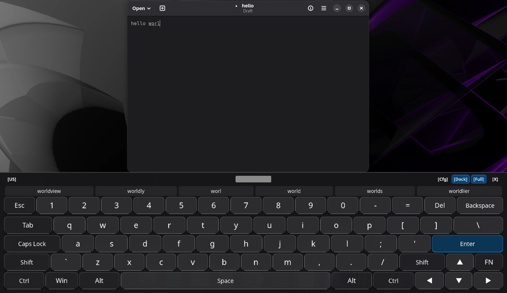
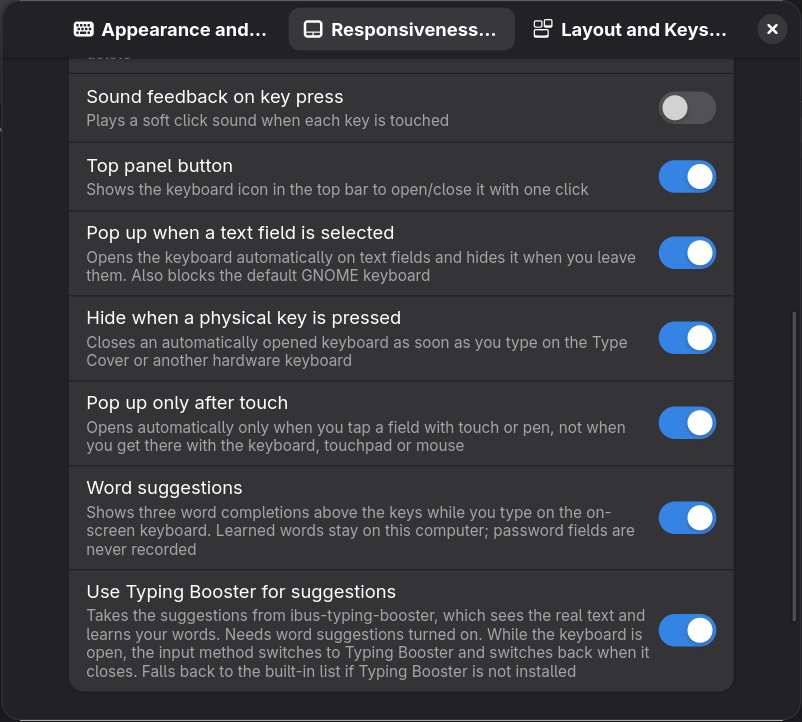

# Apropos OSK


*The opportune on-screen keyboard for GNOME. Built to be the absolute right fit for touch devices.*

## The Problem
If you have ever used a modern Linux touch device running GNOME, you know the frustration: there is a severe lack of on-screen keyboard (OSK) extensions that work reliably, fluidly, and intuitively with touch gestures. The default options often feel clunky, sluggish, or poorly integrated into a modern mobile-first workflow.

## The Solution
Apropos OSK is an on-screen keyboard for GNOME Shell, made for touchscreen laptops and tablets and inspired by the Windows 11 touch keyboard.
It replaces the stock GNOME keyboard. It has a full TKL layout with real modifier keys, opens by itself when you tap a text field, suggests words,
and lets you move the cursor or select text by dragging on the keys.

Author: [BeShO-ShO](https://github.com/BeShO-ShO). Based on [**Fluent OSK**](https://github.com/TbangIT/fluent-osk) (`fluent-osk@tbang`) by [**TbangIT**](https://github.com/TbangIT). See [Credits](#credits).

## Screenshots

The docked keyboard with word suggestions:


The settings window:


## Demo

Move the cursor by dragging on the space bar:


Select and delete text by dragging on Backspace:


## Installation

**From GNOME Extensions** (recommended): install *Apropos OSK* from [extensions.gnome.org](https://extensions.gnome.org) or the Extension Manager app.

**From a GitHub release:** download `apropos-osk@besho-sho.shell-extension.zip` from the [Releases](https://github.com/BeShO-ShO/apropos-osk/releases) page, then run:
```bash
gnome-extensions install --force apropos-osk@besho-sho.shell-extension.zip
```
Log out and back in (needed on Wayland), then enable it:
```bash
gnome-extensions enable apropos-osk@besho-sho
```

**From source:**
```bash
git clone https://github.com/BeShO-ShO/apropos-osk.git
cd apropos-osk && ./pack.sh
gnome-extensions install --force dist/apropos-osk@besho-sho.shell-extension.zip
```

**Requirements:** GNOME Shell 50. Optional: `ibus-typing-booster` for better word suggestions,
and the *Atkinson Hyperlegible Next* font for the default key labels. If that font is missing, the system font is used.

## Features

### Layout and keys
* **TKL layout:** Esc, a combined number/Fn row (F1 to F12), arrows, and all modifiers: Shift, Ctrl, Alt, AltGr, Super and Fn.
  Combinations such as `Ctrl+Alt+Del` and `Super+key` work.
* **Built-in layouts:** Italian (ISO, with the tall Enter key) and US (ANSI).
* **Modifier behavior:** each key can work as a normal key (hold) or as an on/off switch (latch).
* **Modified-key highlight:** while Shift, AltGr or Fn is active, the keys that change symbol are colored. The colors can be changed.
* **Super key:** a tap opens the Activities overview, and holding it with another key sends the combination.
* **Key repeat:** every key repeats when held, with adjustable start delay and speed.
* **Sound feedback:** an optional soft click on each key press.

### Gestures
| Key | Gesture | Result |
| :--- | :--- | :--- |
| `Space` | drag left or right | moves the text cursor one character per step |
| `Backspace` | drag to the left | selects the text before the cursor, deletes it on release |

The sensitivity of both gestures can be set in pixels per character.

### Smart typing
* **Word suggestions:** a suggestion bar above the keys with three completions, the best one in the middle.
  The keyboard learns new words as you type. Learned words stay on your computer, in `~/.config/apropos-osk/`.
* **Typing Booster mode:** suggestions can come from `ibus-typing-booster` instead, which sees the real text and shows six candidates.
  While the keyboard is open the input method switches to Typing Booster, and it switches back when the keyboard closes.
  It is not used in URL, e-mail, password, PIN, number or terminal fields, so browser address-bar completion keeps working.
  If Typing Booster is not installed, the built-in list is used.
* **Privacy:** nothing you type is logged. Password and PIN fields are never recorded and never show suggestions.
* **Auto-pairing:** `()`, `[]`, `{}` and quotes are closed automatically with the cursor in between. Typing the closing character
  out of habit steps over it instead of adding a second one.

### Showing and hiding
* **Opens automatically** when a text field gets focus and closes when you leave it. The stock GNOME keyboard is blocked while this is on.
* **Touch only (optional):** opens automatically only when you tapped the field with a finger or pen, not when you got there with the mouse, touchpad or keyboard.
* **Hide on hardware key (optional):** an automatically opened keyboard closes as soon as you type on a physical keyboard, such as a Type Cover.
* **System dialogs:** in system pop-ups such as password prompts, the stock GNOME keyboard is used, because those dialogs block other keyboards.
* **Lock screen:** it also works on the lock screen, so you can type your password there.
* **Manual toggle:** from a top bar button (can be hidden) or a Quick Settings tile.

### Position and size
* **Docked:** fixed to the bottom of the screen. Drag the bar at the top of the keyboard to change its height.
* **Floating:** a free window you can drag anywhere.
* **Full width (strut mode):** covers the whole bottom of the screen and pushes windows up so no text field is hidden.
  Keys can stay at normal width, centered.
* Width and height as a percentage of the screen, with a separate height for portrait orientation.
* Header buttons to switch layout and mode, open the settings, and close the keyboard.

### Appearance
* Windows 11 style keys with adjustable corner radius.
* Separate horizontal and vertical key gaps, an extra gap below the number row, and padding from the bottom edge.
* Font: *Atkinson Hyperlegible Next* by default, or any installed font picked from a font chooser, with a text size setting.
  Labels shrink only when they do not fit in the key.

### Layout editor
The settings window has a visual editor for a custom layout:
* An interactive preview. Click a key to edit it.
* For each key: its label, its Shift, AltGr and Shift+AltGr characters, its width, its Linux keycode, its color, and whether it is a normal key or a switch.
* Add or remove keys and rows.
* Changes apply live when saved, with no restart. The custom layout is stored in `~/.config/apropos-osk/`.

## Changes from Fluent OSK

Apropos OSK started from [Fluent OSK](https://github.com/TbangIT/fluent-osk), which already had the TKL layout, the dock, floating and full-width modes, key repeat,
the Space and Backspace gestures, auto-pairing, the font and spacing settings and the layout editor. Apropos OSK adds:
* automatic showing and hiding on text fields, with the touch-only and hide-on-hardware-key options
* blocking of the stock GNOME keyboard, and using it on purpose in system dialogs
* word suggestions with word learning, and the Typing Booster mode
* the Quick Settings tile
* the drag bar to resize the docked keyboard, and a separate height for portrait orientation
* a new name, UUID and settings schema, so it can be installed next to the original

## Known issues

None known right now. Bug reports and feature requests are welcome in [Issues](https://github.com/BeShO-ShO/apropos-osk/issues),
but I can't promise to implement every request.

Parts of this extension were written with the help of AI tools. I follow the GNOME version I use myself, so only the current
GNOME Shell release is supported. Help with reviewing and maintaining the code is very welcome.

## Credits

* [**TbangIT**](https://github.com/TbangIT): author of [Fluent OSK](https://github.com/TbangIT/fluent-osk) (`fluent-osk@tbang`), the extension this project is based on.
* [**BeShO-ShO**](https://github.com/BeShO-ShO): Apropos OSK modifications and maintenance.

## License

[GNU General Public License v3.0](LICENSE). Fluent OSK was released under the same license.
Changes made in Apropos OSK are also released under GPLv3.
